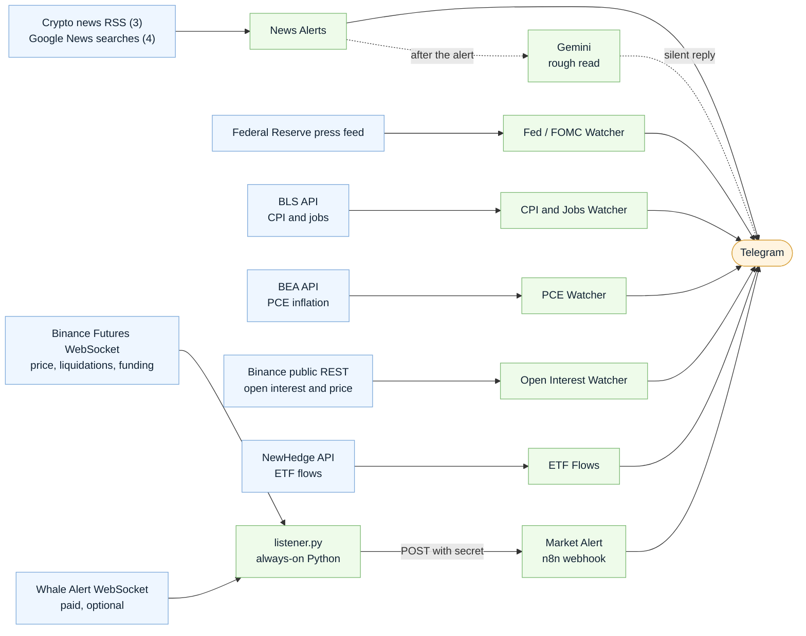
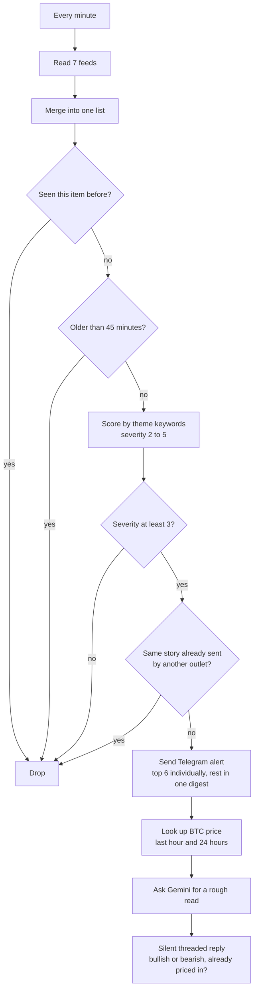
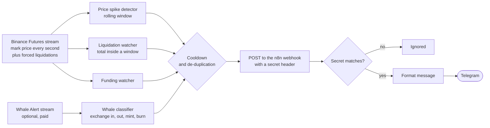
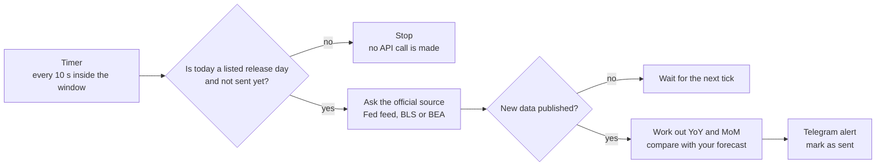
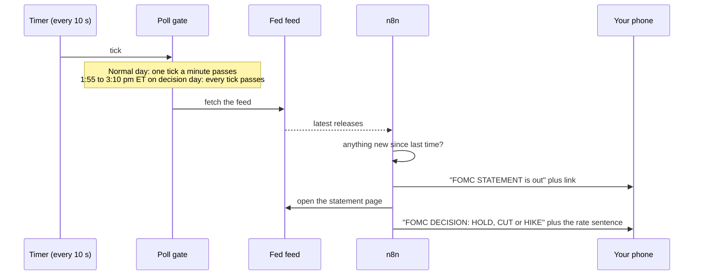

# Crypto News & Market Alerts

A self-hosted alert system for crypto traders who trade off the news. It watches headlines, central-bank decisions, US economic releases, derivatives positioning and whale transfers, and sends **only the things that matter** to your phone through Telegram.

Built with [n8n](https://n8n.io) (the workflows) and a small Python script (the live market listener).

**Why it exists:** following the market meant switching between a news site, a derivatives dashboard, an on-chain tracker and the clock for events like the FOMC decision. This replaces the tab-switching with one alert feed.

> **Status:** the headline alerts with the AI read are **confirmed running live** on an n8n instance, delivering to Telegram (see [See it running](#see-it-running)). Everything is also covered by about 200 automated checks on simulated data (`tests/run_all.sh`). The release-day, open interest, ETF and whale parts have not been confirmed against live data yet, so expect to fix small things (a credential name, a response format) on first run. See [Known limitations](#known-limitations).

---

## Contents

- [What it alerts on](#what-it-alerts-on)
- [See it running](#see-it-running)
- [How it works](#how-it-works)
- [What the alerts look like](#what-the-alerts-look-like)
- [Quick start](#quick-start)
- [Keys and costs](#keys-and-costs)
- [Configuration](#configuration)
- [Design decisions](#design-decisions)
- [Repository layout](#repository-layout)
- [Testing](#testing)
- [Known limitations](#known-limitations)
- [Roadmap](#roadmap)
- [Disclaimer](#disclaimer)

---

## What it alerts on

| Area | Examples | How fast | Workflow |
|---|---|---|---|
| **Headlines** | Wars and oil, shipping routes, Trump and markets, inflation, big companies' moves, hacks, regulation | Checked every minute | News Alerts |
| **Central bank** | FOMC statement, rate decision (hike, cut or hold), projections, minutes | Every 10 s during release windows | Fed / FOMC Watcher |
| **US economic data** | CPI, jobs report, PCE inflation, compared with the forecast you type in | Every 10 s from 8:29 am ET on release day | CPI and Jobs Watcher, PCE Watcher |
| **Live market** | Price spikes, liquidation cascades, extreme funding rates | About 1 second | Market Alert + `listener.py` |
| **Positioning** | Open interest jumping or collapsing, with the price move beside it | Every 5 minutes | Open Interest Watcher |
| **Big money** | Large whale transfers onto or off exchanges, stablecoin mints and burns (paid feed) | About 1 second | Market Alert + `listener.py` |
| **Fund flows** | Daily net flow of US spot Bitcoin ETFs | Once a day | ETF Flows |
| **AI second opinion** | A rough bullish / bearish read on each headline, and whether the market has already reacted | A few seconds after the alert | News Alerts |

---

## See it running

Real alerts in Telegram. Each headline alert is followed by a silent reply from the AI step; the quoted line at the top of each bubble is the alert it answers. Two of these three headlines are noise (a Senate race, Australian inflation), and the AI marks them "unclear" with low confidence. That is the safety net doing its job, and it also shows where the keyword lists can be tightened (see [Configuration](#configuration)).

<p align="center">
  
</p>

The workflows running together on one n8n canvas: the live market and positioning watchers at the top, the news funnel with its AI follow-up along the bottom.

<p align="center">
  
</p>

---

## How it works

### The big picture

Three layers: **ingest** (pull or receive data), **decide** (filter, score, de-duplicate, wait for the right moment) and **deliver** (Telegram).



### Headline alerts (News Alerts workflow)

Every minute, seven feeds are read and every new headline goes through the same funnel. Most items are dropped; the few that survive are sent at once.



Things worth knowing about this funnel:

- **The alert goes out first.** The AI step runs *after* it, so a slow or failed AI call never delays an alert.
- **Themes** are FED / MACRO, OIL / GEOPOLITICS, TRUMP, INSTITUTIONAL, SECURITY and REGULATION. Severity rises for big money amounts, buy or sell wording, urgent words ("surprise", "plunge") and hits in several themes at once.
- **The same story from ten outlets is sent once** (headline wording is compared).
- **The AI is told to say "unclear"** when a headline isn't clear-cut, and it sees the current BTC price so it can judge whether the market already moved.

### Live market events (`listener.py` + Market Alert workflow)

A small Python script holds WebSocket connections open, runs three detectors (plus an optional whale classifier) and posts events to n8n. n8n checks a shared secret, formats the message and sends it.



### Release-day watchers (Fed, CPI, jobs, PCE)

These events happen at known times, so there is no point polling all day. A **gate** step lets a poll through only inside the release window, retries every 10 seconds until the new number appears, sends one alert, and then stops calling the API for that day.



On an FOMC decision day the sequence looks like this:



### Speed: where the delay comes from

| Part | Typical delay | Why |
|---|---|---|
| Price, liquidation, funding, whale events | About 1 second | Live WebSocket streams, no polling |
| Fed, CPI, jobs, PCE | Up to 10 seconds after the source publishes | Polled every 10 s inside the window. How quickly the source itself updates is outside this project's control |
| Headlines | Up to a minute, plus the outlet's own delay | RSS polled every minute |
| Open interest | Up to 5 minutes | Polled every 5 minutes |
| ETF flows | Daily | Published once per trading day |

This is built so you **never miss and never scramble**, not to out-race trading firms that use direct feeds.

---

## What the alerts look like

Numbers below are illustrative. The text layout is what the code produces.

<details>
<summary><b>Headlines and the AI read</b></summary>

```text
🚨🚨 FED / MACRO
Fed cuts rates by 25bps in surprise move
CoinDesk
https://www.coindesk.com/...

   ↳ (silent reply)
🧠 Rough read: 🟢 bullish (medium confidence)
A surprise cut usually loosens liquidity, which has favoured risk assets.
Already priced in? partly
Check: Dollar index and BTC reaction at the open
Headline-only guess, not trading advice.
```
</details>

<details>
<summary><b>Fed / FOMC</b></summary>

```text
🏛 FOMC STATEMENT
Federal Reserve issues FOMC statement
https://www.federalreserve.gov/newsevents/pressreleases/...

🏛 FOMC DECISION: ⬇️ CUT
In support of its goals, the Committee decided to lower the target range for the
federal funds rate by 1/4 percentage point to 4.25 to 4.5 percent.
```
</details>

<details>
<summary><b>CPI, jobs and PCE</b></summary>

```text
📊 US CPI — October 2026
Headline: 3.0% YoY (prev 2.9%) | +0.3% MoM
Core: 3.1% YoY (prev 3.0%) | +0.2% MoM
Headline YoY: BELOW expected (3.1%)
Core MoM: BELOW expected (0.3%)
https://www.bls.gov/news.release/cpi.nr0.htm

👷 US Jobs report — October 2026
Payrolls: +85K (prev month +120K, as revised)
Unemployment: 4.5% (prev 4.4%)
Avg hourly earnings: +0.4% MoM | +3.8% YoY
Payrolls: BELOW expected (150K)

🧾 US PCE inflation: September 2026
Headline: 3.0% YoY (prev 3.0%) | +0.3% MoM
Core: 2.4% YoY (prev 2.4%) | +0.2% MoM
```
The "expected" lines appear when you type your forecast into the workflow before the release.
</details>

<details>
<summary><b>Live market events</b></summary>

```text
🚨 🟢⬆️ BTCUSDT +2% in 5m
Price: 102000

🚨 💥 ETHUSDT liquidations $15,000,000 in 60s
Longs wiped: $14,000,000
Shorts wiped: $1,000,000

⚠️ 💸 XRPUSDT funding 0.15%
Longs are paying shorts (crowded long)

🚨🚨 🐋 BTC $156,000,000 moved TO an exchange
1,500 BTC
unknown → Binance
Coins moving onto an exchange. Often read as possible selling pressure, but it
can also be collateral or internal moves.
```
</details>

<details>
<summary><b>Positioning and ETF flows</b></summary>

```text
📈 BTCUSDT open interest +3.0% in 1h
1h: +3.0% | 4h: +3.0%
Open interest now: 103,000 BTC (about $10.30B)
Price (spot): +1.2% in 1h | +1.5% in 4h
Usual reading: New long positions piling in alongside rising price.

🏦 US spot Bitcoin ETFs: Oct 22
🟢 Net flow: +$524.8M (inflow)
Last 5 trading days: +$1.07B
3 inflow days in a row
Provisional: the latest day can be revised as funds report.
```
</details>

Notification loudness follows severity: low-severity alerts and every AI reply arrive **silently**, serious ones make a sound.

---

## Quick start

**You need:** an n8n instance (self-hosted is best, see the note below), Python 3.10+, and a Telegram account. Node 18+ is only needed to run the tests.

### 1. Create a Telegram bot

1. In Telegram, message **@BotFather**, send `/newbot` and follow the prompts.
2. Copy the bot token and keep it safe.
3. Open a chat with your new bot and send it any message.
4. Open `https://api.telegram.org/bot<YOUR_TOKEN>/getUpdates` in a browser and read `message.chat.id`. That is your **chat ID**.

> **About the token:** paste the **whole** token exactly as BotFather gave it, including the number at the start and the colon (for example `123456789:AAH...`). Do **not** add the word `bot` in front of it in n8n. That prefix is only used in the raw URL in step 4.

### 2. Get the code

```bash
git clone https://github.com/<your-username>/crypto-news-alerts.git
cd crypto-news-alerts
```

### 3. Import the workflows into n8n

In n8n, choose **Workflows → Import from file** and import the files in `n8n/workflows/`. **Do one at a time**: import, set it up, test it, activate it, then move on.

| File | Needs (besides Telegram) |
|---|---|
| `n8n-market-alert-workflow.json` | A secret string, set in the **Check secret** node |
| `n8n-news-alerts-workflow.json` | Gemini API key (optional, for the AI replies) |
| `n8n-fed-watcher-workflow.json` | Nothing |
| `n8n-cpi-jobs-watcher-workflow.json` | Free BLS API key |
| `n8n-pce-watcher-workflow.json` | Free BEA API key |
| `n8n-open-interest-workflow.json` | Nothing |
| `n8n-etf-flows-workflow.json` | NewHedge API token |

In **every** workflow:

1. Open the **Telegram** node(s), create a credential with your **Access Token** (the full token), and replace `YOUR_TELEGRAM_CHAT_ID` with your chat ID.
2. Fill in that workflow's key, as in [Keys and costs](#keys-and-costs).
3. Click **Execute workflow** once to test, then switch the workflow to **Active**.

### 4. Start the live listener

```bash
pip install -r requirements.txt
cp .env.example .env        # then edit .env: webhook URL, secret, watchlist
set -a; source .env; set +a
python listener/listener.py
```

Use the **Production URL** of the Market Alert webhook (not the test URL) and the same secret you put in the **Check secret** node. The listener prints every alert in the terminal too, so you can run it with no webhook URL first, just to see what it detects.

Keep it running around the clock on a small server with a systemd service. An example is in [docs/guide.md](docs/guide.md).

> **Self-hosted n8n is strongly recommended.** The release-day watchers tick every 10 seconds, which can use up the execution quota of a hosted plan quickly. Also check where your server is: Binance blocks its futures API in some countries (for example the US), and the listener and Open Interest workflow need it.

The step-by-step version for every part, with settings and limits, is in **[docs/guide.md](docs/guide.md)**.

---

## Keys and costs

Prices are what I saw in October 2026. Check each provider before relying on them.

| Service | Used for | Where the key goes | Cost |
|---|---|---|---|
| Telegram bot | Delivering every alert | n8n **Telegram** credential, field *Access Token* | Free |
| Google Gemini | AI "rough read" replies | n8n **Header Auth** credential: name `x-goog-api-key`, value your key | Free tier has rate limits |
| BLS API | CPI and jobs numbers | `BLS_KEY` line in the **Poll gate** node | Free (without a key only 25 requests a day) |
| BEA API | PCE inflation | `BEA_KEY` line in the **Poll gate** node | Free |
| NewHedge API | ETF flows | n8n **Query Auth** credential: name `api_token`, value your token | Not confirmed; check their plans |
| Whale Alert | Whale transfers (optional) | `WHALE_ALERT_API_KEY` in `.env` | Paid, about $30 a month at the time, with a 7-day trial |
| Binance public data | Prices, open interest, live stream | none | Free |

> **Never commit real keys.** `.env` is in `.gitignore`, and the workflow files in this repo contain placeholders only. If you export a workflow from n8n after filling in a key, don't commit that export.

I looked at Coinglass for derivatives data. It has no free plan, and its cheapest plan only gives 4-hour data, so I used Binance's free public data instead. Liquidations come live from the listener.

---

## Configuration

Everything you are likely to tune sits at the top of a file, in a block marked `SETTINGS`.

| What you want to change | Where |
|---|---|
| Alert sensitivity for headlines (`MIN_SEVERITY`), keyword lists, how old a story may be | `n8n/code/news-filter.js` |
| Which coins the live listener watches, spike size, liquidation size, funding level | `.env` (see `.env.example`) |
| Open interest thresholds and coin list | `n8n/code/oi-evaluate.js`, `n8n/code/oi-requests.js` |
| FOMC release windows (add or remove dates) | `n8n/code/fed-gate.js` |
| CPI and jobs dates, and **your forecast** for each release | `n8n/code/econ-gate.js` |
| PCE dates and your forecast | `n8n/code/pce-gate.js` |
| ETF "big flow" size | `n8n/code/etf-format.js` |
| Which Gemini model is used | `n8n/code/gemini-request.js` |

The code in `n8n/code/` is the **source of truth**. After editing a file, rebuild the importable workflows and re-import them:

```bash
python tools/build_workflows.py
```

---

## Design decisions

- **Alert first, analyse second.** The plain alert is sent immediately. The AI note arrives as a reply a few seconds later, and if it fails you lose nothing.
- **Don't poll when nothing can happen.** Release-day watchers only call an API inside their window, and stop for the day once they have sent.
- **Fail quietly, but say so once.** A network hiccup is retried silently. A real problem (a bad key, a hit limit) sends one warning, not one every 10 seconds.
- **Say "unclear" rather than guess.** The AI is told to admit uncertainty, and when the BTC price is unavailable it says so. If a figure can't be worked out, the alert shows "n/a" and a link instead of a made-up number.
- **Never alert twice for the same thing.** Items already seen, the same story from another outlet, and repeats within a cooldown are all held back.
- **Secrets stay out of files.** Credentials live in n8n or `.env`; the webhook requires a shared secret so a stranger who finds the URL can't send you fake alerts.
- **Code lives in plain files.** The logic inside each n8n node is kept as readable `.js` files that can be diffed, tested and reviewed, and the workflow JSON is generated from them (the same input always gives the same output).

---

## Repository layout

```text
crypto-news-alerts/
├── README.md                  this file
├── .env.example               settings for the listener (copy to .env)
├── requirements.txt           Python dependencies for the listener
├── listener/
│   └── listener.py            always-on script: price spikes, liquidations, funding, whales
├── n8n/
│   ├── workflows/             the 7 importable n8n workflows (generated)
│   └── code/                  the code inside each workflow node (source of truth)
├── tools/
│   └── build_workflows.py     builds n8n/workflows from n8n/code
├── tests/                     test suites and run_all.sh
└── docs/
    ├── guide.md               detailed setup, settings and limits for every part
    └── images/
        └── architecture.png   the big-picture diagram as an image (for slides and posts)
```

---

## Testing

```bash
pip install -r requirements.txt
./tests/run_all.sh
```

This runs six suites (about 200 checks) with Node and Python. They feed the detection and formatting code simulated API responses and check both the normal path and the failure paths: bad keys, blocked countries, empty or garbled responses, stale data, duplicate items, daylight-saving boundaries, floods of alerts.

**What the tests do not cover:** none of them talks to a real service or runs inside n8n. They prove the logic handles the response formats I expect; they cannot prove those formats are exactly what the providers send.

---

## Known limitations

- **Only the news and AI path is confirmed live.** The BLS, BEA, Whale Alert, NewHedge and open interest parts were built from documentation and simulated responses. If a first real alert shows "n/a" or doesn't arrive, look at the HTTP node's output in n8n first. The BEA monthly period format is my main assumption.
- **Release dates need upkeep.** The windows and release dates are typed into the gate nodes. Dates in the past are simply never matched; add new ones as the agencies publish them. The FOMC statement time (2:00 pm ET) is the Fed's usual practice, not something its calendar states.
- **Keyword matching is blunt.** Expect some irrelevant alerts and a few misses in the first week. Tune the thresholds.
- **The AI sees only the headline and the BTC price.** It doesn't see the article or what the market expected. Its "already priced in" call is a guess from one price move. Treat it as a second opinion, never a signal.
- **Whale data is paid, and exchange labels are incomplete.** An exchange missing from my name list shows as an ordinary wallet, and the alert says the direction can't be read.
- **Binance region limits.** Some countries are blocked from the futures API.
- **Speed has a floor.** One-minute headline polling and the outlets' own delay mean this is for awareness, not for racing bots.

---

## Roadmap

- A "what did BTC do in the five minutes after" follow-up for each major release.
- Aggregated cross-exchange derivatives data (for example Coinglass) if a paid plan is worth it.
- One combined morning digest of everything that happened overnight.

---

## Disclaimer

This project sends **information**, not trading signals. Directions like "bullish" or "possible selling pressure" are common rules of thumb or an AI's rough guess from a headline, and they are often wrong. Nothing here is financial advice, and you are responsible for your own trading decisions.
# Crypto-News-and-Market-Alerts

